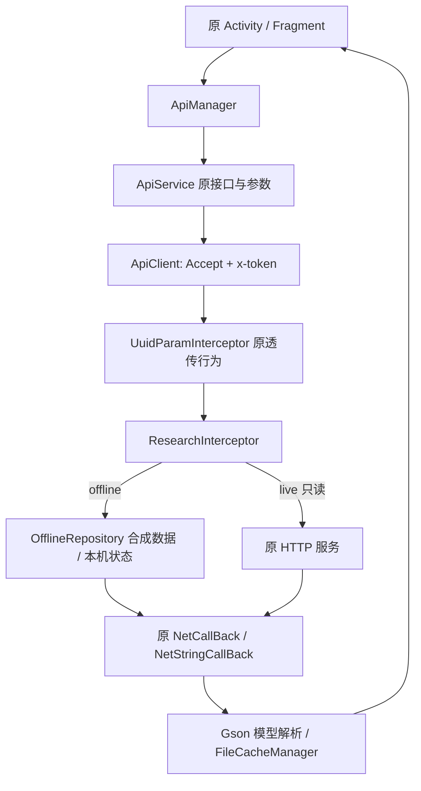

# 网络、媒体和数据研究入口

## 原网络链



`ApiService.java` 保留 60 个声明，包括 HTTP 动词、Query/Body/Form/Multipart。`ApiManager` 保留每项业务的参数组合和回调。公共头为 `Accept: application/json`，登录时增加 `x-token`。**原 `UuidParamInterceptor` 只重新构造 URL，没有注入 UUID**，没有因类名擅自添加头。

邀请归因与 UUID/签名线索在 `ApiManager.getUuid`、`MainActivity.onStart` 和 `ApiManager.postShare`。原邀请码签名使用 `MD5(shareId + '-' + 日期 + '-mogu-' + uuid)` 的指定子串；不是全局接口 AES 签名。原业务代码完整保留，研究模式不向线上自动提交归因。

原响应 envelope 使用 `code`、`message`、`data`。`NetCallBack` 处理 1/200/201/302、403 等原业务码；连接、网络、空结果与解析错误沿原回调返回。没有用固定成功替代失败。`NetStringCallBack` 的原始字符串协议用于 DNS TXT、验证码等，不能都当成同一种 envelope。

超时仍为连接/读/写各 30 秒。TLS 改为系统证书链和主机名校验；原 `App` 全局信任所有证书和 `SSLOkhttp` 的宽松校验已移除。失效证书不再被静默接受。

## HLS 清单加密

调用入口：`DetailsActivity` / `ArouterUtils` / `ShortVideoMainFragment` 将 `(内容 id, play_url)` 保存到 `PlayIdSaveUtils`。播放器使用 `ExoMyPlayerManager → IjkExoMyMediaPlayer → ExoMySourceManager → HlsMyMediaSource.Factory → MyHlsPlaylistParserFactory → HlsMyPlaylistParser`。

原 `ExoMySourceManager.getMediaSource` 走自定义 HLS 源，不能因为 URL 没有 `.m3u8` 就改成普通 MP4 源。离线短视频样例也沿该 HLS 链。

`HlsMyPlaylistParser` 对 URL **不含** `m3u8` 的内容尝试：

```text
id = PlayIdSaveUtils[url]
sha = SHA1(UTF8(id)) 的小写十六进制文本
keyHex = MD5(UTF8(sha)) 的小写十六进制文本
key = HEX_DECODE(keyHex)       // 16 字节
plaintext = AES/CBC/PKCS5Padding(key, IV=key, responseBytes)
```

然后交给版本明确的官方 ExoPlayer **2.18.1** `HlsPlaylistParser`，保留主清单、媒体清单、分片和标准 HLS 处理，避免复制整份第三方解析器。明文回退使用原始字节，错误密钥最终仍被 HLS header 校验拒绝。没有把无法解密的输入变成一个虚假的成功播放列表。

合成向量 `id=1002` 的 keyHex 为 `d93ecb04bf038154a1e2f6b2a848bc32`。这只是公开的合成测试输入派生结果，不是后台凭据。

## 图片解密

实际注册路径：`GeneratedAppGlideModuleImpl → DecryptAppGlideModule.registerComponents → HttpGlideUrlLoader → HttpMyUrlFetcher`。

- 普通封面：取 URL 最后一个路径片段、首个点之前的文件名，`keyHex=MD5(filename)`。
- URL 含 `vlog`：`keyHex=MD5(SHA1(filename) 的小写十六进制文本)`。
- AES-CBC 的 key 与 IV 同为 HEX_DECODE(keyHex)。

原实现解密失败后把已经读取到底的 InputStream 交回 Glide，导致未加密图片也可能加载失败。恢复版先保留字节，再选择解密结果或原始字节；重定向次数、取消与清理仍沿原 DataFetcher 协议。

`CXAESUtil.encrypt` 使用 provider 的 `AES`（原 ECB 路径）；`encrypt2Java` 使用 CBC/零 IV；`decrypt` 使用 key 本身作 IV。这几个方法并非互相配对的同一协议。业务媒体实际走上述 `decrypt` 路径；未因工具类存在就宣称所有方法都接入业务。

## 播放状态与缓存

- `DetailsVideoView`、`ShortVideoView` 保留原 GSY UI。GSY 使用兼容 ABI 的官方 8.3.4 依赖，精确的原 GSY 版本没有从 APK 直接确认；ExoPlayer 2.18.1 有 APK 常量证据。
- 原 `IjkExoMyMediaPlayer` 把 `onPlayWhenReadyChanged(boolean, reason)` 的第二个参数当成播放状态。恢复版将两个监听入口分开，读取真正的 `getPlaybackState()` / `getPlayWhenReady()` 后进入共享状态处理。原缓冲、准备完成、播放完成及 seek 通知继续保留。
- 对照接口：[ExoPlayer 2.18.1 Player.Listener](https://github.com/google/ExoPlayer/blob/r2.18.1/library/common/src/main/java/com/google/android/exoplayer2/Player.java)。
- Exo 的播放/查询操作必须在播放器所属主线程执行，设备验证按此测量真实进度。
- `ExoMySourceManager` 的 LRU 缓存上限仍为 512 MiB；`ExoMyPlayerCacheManager` 保留清理和缓存接入。原 `PlayDataSaveUtils`、`SpUtil`、`FileCacheManager` 保留播放进度、偏好设置与 JSON 数据缓存。
- `CacheInterceptor` 类存在，但原 `ApiClient` 没有安装它；不要将其误记为正在使用的 HTTP 缓存。API JSON 缓存走原 `NetCallBack` / `FileCacheManager`。
- `App` 为 offline/live 分开 SharedPreferences 名称以及文件、缓存目录。原基础库仍走其既有存储 API，不在页面层添加第二套缓存实现。

## 受控离线适配器

`OfflineRepository` 只在 offline 模式创建。它读取带来源说明的 `assets/research/catalog.json`，对已实现的本机操作做参数验证并持久化状态；未知路径、错误参数、错误密码及缺少受控上传服务均返回明确错误。

`AssetServer` 仅监听 `127.0.0.1` 的随机端口，为实际 Glide/Exo 请求提供合成媒体，支持 HTTP Range/HEAD。它不运行恢复的服务端，不暴露到局域网，也没有接管真实 API 的失败结果。

原始业务请求、成功/失败解析和原 UI 消费这些响应的代码仍能被研究。数据来源同时体现在界面标识、`X-Mushroom-Data-Source`、离线 envelope 的 `_source`，以及按模式隔离的存储中。
